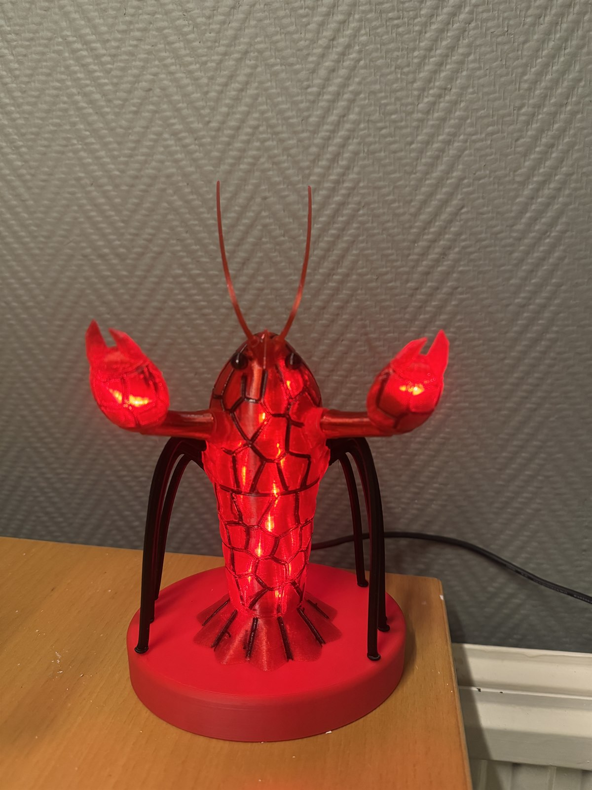
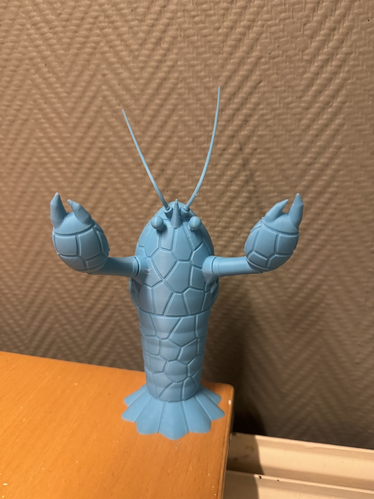
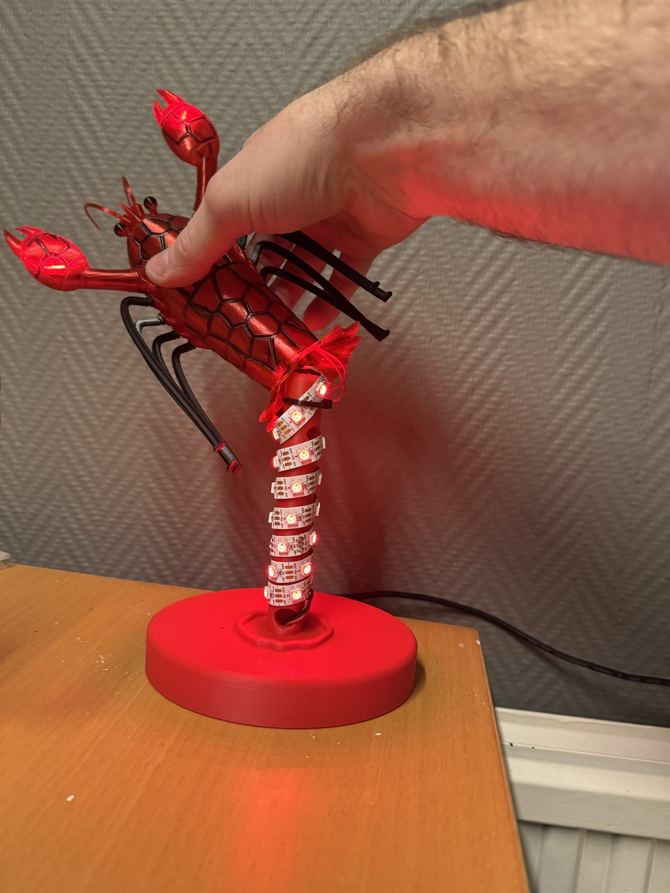
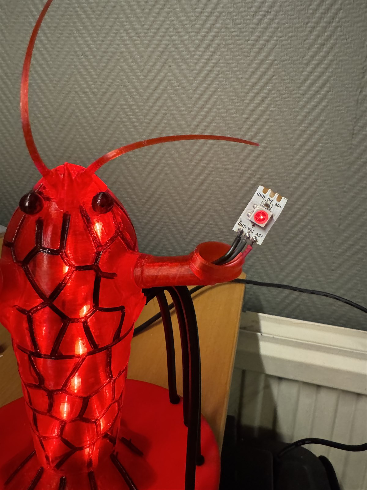
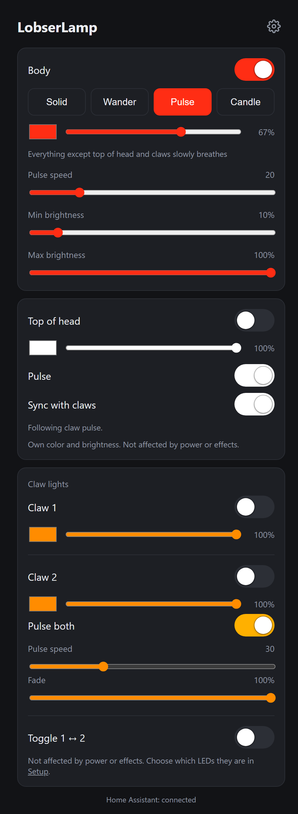
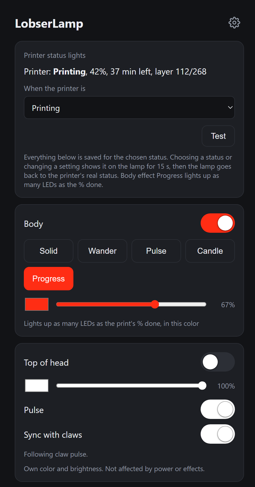
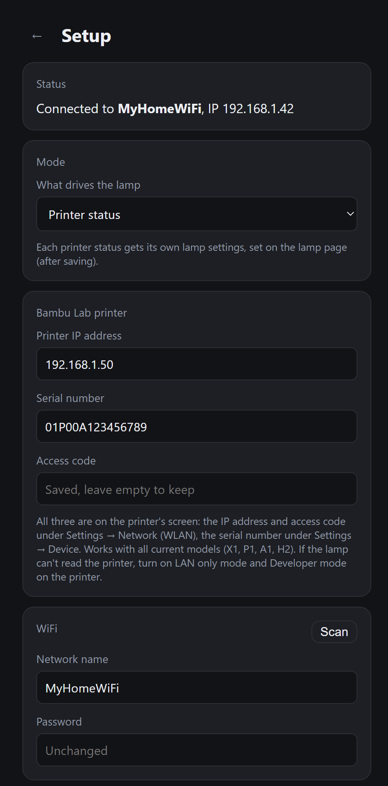

# LobserLamp

**A smart lobster lamp for Home Assistant and your Bambu Lab printer.**

<p align="center">
  
  &nbsp;
  
</p>

<h3 align="center">🎬 See it in action</h3>

https://github.com/user-attachments/assets/f4132fd1-b6fc-4d08-82e3-bcee4929d509

<p align="center"><sub>Video not playing? <a href="images/lobser1.mp4?raw=true">Download it</a> (MP4, 9 MB).</sub></p>

- **Home Assistant:** the lamp shows up by itself with every light and effect ready to use in your automations, scenes and dashboards.
- **Bambu Lab printer:** the lamp becomes a print monitor. The body fills up as your print grows, and the claws and head show at a glance whether the printer is printing, paused, finished or has failed.
- **An easy web page built in:** open the lamp's address in any browser, on your phone or computer, and set everything with big buttons, switches and sliders. There's no app to install and no account to create. [See what it looks like](#the-web-page).

Inside, an ESP32 drives a strip of colour LEDs: most of them light the **body**, one lights the **top of the head**, and two light the **claws**. The standard 31-LED lamp runs straight off the ESP32 board's 5 V pin, with no separate power supply.

You don't need to write code or install anything. If you can plug in a USB cable and connect three wires, you can build one.

---

## Quick start

| Step | What you do | Time |
|---|---|---|
| 1 | [Get the parts](#1-get-the-parts) | – |
| 2 | [Wire the LED strip](#2-wire-the-led-strip) (3 wires) | 10 min |
| 3 | [Flash the firmware](#3-flash-the-firmware) from your browser | 2 min |
| 4 | [Connect it to your WiFi](#4-connect-it-to-your-wifi) | 2 min |
| 5 | [Tell it which LEDs are the claws and head](#5-choose-the-claws-and-the-head) | 2 min |
| 6 | [Connect Home Assistant or your Bambu Lab printer](#6-connect-home-assistant-or-your-printer) | 5 min |

### 1. Get the parts

| Part | What to buy |
|---|---|
| **ESP32 board** | Most classic **ESP32 dev boards** (such as the Olimex ESP32-DevKit-LiPo), or the tiny, cheap **ESP32-C3 Super Mini**. It needs a **5V** pin (sometimes labelled **VIN** or **VBUS**) to power the strip. Not sure about your board? See [which ESP32 variants work](#other-boards). |
| **LED strip** | An addressable **5 V RGB** strip, such as **WS2812B** (the most common), WS2812, WS2813 or SK6812 RGB. The standard lamp uses **31 LEDs**; up to 127 are supported. |
| **USB phone charger** (1 A or more) and a USB cable | Powers the whole lamp. A computer's USB port works for flashing, but may not give enough current to light the LEDs brightly. |
| **3 wires**, and optionally a **330 Ω resistor** | The resistor makes the data signal cleaner. |

> **Separate power supply?** Not needed for the standard 31-LED lamp. You only need one for a much longer strip or for very bright white light, see [When to add a separate power supply](#when-to-add-a-separate-power-supply).

> **Won't work:** RGBW strips (4 colour channels), strips with a separate clock wire (APA102, SK9822), and plain single-colour or "dumb" RGB strips with no chips on them.

### 2. Wire the LED strip

<p align="center">
  
  &nbsp;
  
  <br>
  <em>Left: the strip spirals around a post in the base, and the lobster body slides down over it.<br>Right: each claw holds a single LED cut from the strip, wired through the arm with three thin wires.</em>
</p>

An LED strip has three wires: **5V** (power), **GND** (ground) and **DIN** (data in). All three go straight to the ESP32 board. Data only flows one way, so look for the small **arrows** printed on the strip and connect to the end the arrows point **away** from.

```
                ESP32                      LED strip  (arrows point this way ➜)
              ┌─────────┐                ┌─────────────────────────────────
              │   5V  ──┼────────────────┤ 5V
              │  GND  ──┼────────────────┤ GND
              │ GPIO 13 ┼──[330 Ω]───────┤ DIN       (the resistor is optional)
              │   USB   │                └─────────────────────────────────
              └────┬────┘
                   └── USB phone charger (1 A or more)
```

1. **Strip 5V → the board's 5V pin.** The strip gets its power from the USB cable, through the board.
2. **Strip GND → the board's GND pin.**
3. **Strip DIN → GPIO 13**, ideally through a 330 Ω resistor. GPIO 13 is the default; you can pick another pin later on the setup page. **On an ESP32-C3 Super Mini, use GPIO 4 instead**: it sits right next to the 5V and GND pins.
4. **Plug the board into a USB phone charger.** For flashing, plug it into your computer instead.

That's the whole build.

**Why this works without a big power supply:** each LED draws up to 60 mA, but only at full white and full brightness. The lamp normally shows one colour, which uses just one of the LED's three colour channels. With 31 LEDs in red at the default brightness, the LEDs draw a few hundred mA, which a phone charger and the board handle comfortably.

**If the board restarts or the LEDs flicker when they get bright** (most likely with bright white on every LED):
- lower **Max brightness** on the setup page. The lamp never goes above that cap, and the current drops with it;
- use a stronger USB charger (2 A); or
- add a separate power supply (below).

On some boards the 5V pin goes through a small diode or fuse that can't take much current. If yours struggles even with colours, that's the likely cause.

#### When to add a separate power supply

You need one if you use **many more LEDs** than the standard 31, or want **full white at full brightness**. Each LED can draw up to about **60 mA**:

| LEDs | Worst case (full white, full brightness) | Suggested supply |
|---|---|---|
| 31 (standard) | ≈ 1.9 A | Not needed for colours; 5 V, 2–3 A for full white |
| 60 | ≈ 3.6 A | 5 V, 4 A |
| 127 (max) | ≈ 7.6 A | 5 V, 8 A, or keep the brightness down |

With a separate supply, the strip takes its power from the supply, and the supply and the board share a ground:

```
  5 V power supply                         LED strip
  ┌───────────┐                          ┌─────────────────────────────────
  │  +5V  ────┼──────────────────────────┤ 5V
  │  GND  ────┼─────────────┬────────────┤ GND
  └───────────┘             │        ┌───┤ DIN
                            │        │   └─────────────────────────────────
                ESP32       │        │
              ┌─────────┐   │        │
              │  GND  ──┼───┘        │
              │ GPIO 13 ┼──[330 Ω]───┘
              │   USB   │ ← USB charger or computer
              └─────────┘
```

- **Strip 5V → supply +5V.** Don't also connect the board's 5V pin to the strip.
- **Strip GND → supply GND *and* board GND.** This shared ground is essential: without it, the data signal has nothing to be measured against, and the LEDs flicker or stay dark.
- **Strip DIN → GPIO 13**, as before.

#### If the colours flicker or look wrong

- **Red and green are swapped:** change **Color order** on the setup page. WS2812B strips are usually **GRB**; try **RGB**.
- **Random flicker or sparkles:** check the GND wire first. Then add the 330 Ω resistor and keep the data wire short. A 1000 µF capacitor across the strip's 5V and GND also helps.
- **Still unreliable:** the ESP32 sends a 3.3 V data signal, and some strips want closer to 5 V. A **level shifter** chip such as the 74AHCT125 fixes that.

### 3. Flash the firmware

You only need a browser. There's nothing to install and nothing to build.

1. Plug the ESP32 into your computer with a USB cable.
2. Open the **[LobserLamp web flasher](https://eliasm86.github.io/LobserLamp/)** in **Chrome** or **Edge** on a computer. Firefox, Safari and phones can't do this.
3. Click **Install**, choose the ESP32's port in the list, and confirm.
4. Wait about a minute while it flashes. When it's done, the flasher offers **Connect to Wi-Fi**. Pick your network, type the password, and click **Visit device**.

That's it! The lamp lights up and its control page opens. If you did the WiFi step here, you can skip step 4.

**No port in the list?**
- Try another USB cable. Many cables are charge-only and carry no data.
- Install the driver for your board's USB chip: [CH340](https://www.wch-ic.com/downloads/CH341SER_EXE.html) or [CP210x](https://www.silabs.com/developers/usb-to-uart-bridge-vcp-drivers).

**Flashing won't start?** Hold the **BOOT** button on the board while you click **Install**.

### 4. Connect it to your WiFi

A freshly flashed lamp doesn't know your WiFi yet, so it creates its own network:

1. On your phone, join the WiFi network **`LobserLamp-XXXX`**. It has no password.
2. The setup page pops up by itself. If it doesn't, open **http://192.168.4.1/setup**.
3. Tap **Scan**, pick your network, enter the password, and tap **Save and restart**.
4. Your phone goes back to your normal WiFi. Open **http://lobserlamp.local/**, or find the lamp's IP address in your router.

If the lamp ever loses your WiFi, it brings this setup network back by itself (see [When WiFi is lost](#when-wifi-is-lost)).

### 5. Choose the claws and the head

The lamp has to know which LEDs on the strip sit in the claws and on top of the head.

1. On the lamp page, tap the **gear icon** to open Setup.
2. Under **LED roles**, choose an LED for **Top of head**, **Claw 1** and **Claw 2**.
3. Tap **Flash** next to each one. The chosen LED blinks three times so you can see exactly where it is. These changes apply right away.

All other LEDs belong to the body.

### 6. Connect Home Assistant or your printer

Now for the fun part. Pick one, or use both:

- **Home Assistant:** enter your MQTT broker on the setup page, and the lamp appears in Home Assistant by itself. See [Home Assistant](#home-assistant).
- **Bambu Lab printer:** switch the mode to **Printer status** and enter the printer's IP address, serial number and access code. Then choose what the lamp shows for each printer status. See [Printer status](#printer-status-bambu-lab).

Your lobster is ready. 🦞

---

## The web page

Everything is set from a simple web page that the lamp serves itself. Open **http://lobserlamp.local/** (or the lamp's IP address) in any browser, on your phone or computer. Every change shows on the lamp instantly, and it's saved automatically.

<table>
  <tr>
    <td align="center" width="33%"></td>
    <td align="center" width="33%"></td>
    <td align="center" width="33%"></td>
  </tr>
  <tr>
    <td align="center"><b>Lamp page</b><br><sub>Colours, effects, claws and head</sub></td>
    <td align="center"><b>Printer status</b><br><sub>A look for every printer status</sub></td>
    <td align="center"><b>Setup</b><br><sub>WiFi, Home Assistant, printer, LEDs</sub></td>
  </tr>
</table>

### Lamp page

**Body**
- On/off, colour and brightness.
- Four effects:
  - **Solid**: one steady colour.
  - **Wander**: a dot travels end to end and back. You set its speed and tail length.
  - **Pulse**: slow breathing. You set the speed and the lowest and highest brightness.
  - **Candle**: flickers like a real flame. You set the flicker speed.

**Top of head**
- On/off, its own colour and brightness.
- **Pulse** makes it blink or breathe. **Fade** goes from a hard blink (0 %) to smooth breathing (100 %).
- **Sync with claws** makes the head follow the claws while they pulse or toggle.

**Claws**
- Each claw has its own on/off, colour and brightness.
- **Pulse both**: both claws breathe together, each in its own colour, with speed and fade settings.
- **Toggle 1 ↔ 2**: the claws take turns. With fade, they cross-fade into each other.
- Only one claw pattern runs at a time: turning one on switches the others off.

The body's on/off switch and effects never touch the head or the claws.

### Setup page (gear icon)

| Section | What you set |
|---|---|
| Mode | **Lamp Mode** or **Printer status** (see [Printer status](#printer-status-bambu-lab)) |
| Bambu Lab printer | The printer's IP address, serial number and access code (Printer status only) |
| WiFi | Network (with scan) and password |
| Device | Name shown in Home Assistant, and the hostname (`http://<hostname>.local`) |
| Home Assistant (MQTT) | Server (empty = off), port, user, password |
| LED strip | Data pin, number of LEDs, colour order, max brightness |
| LED roles | Which LED is the top of head, claw 1 and claw 2. These apply immediately. |

**Save and restart** applies everything except LED roles.

Passwords and the printer access code are never shown again. An empty field keeps the saved value. The access code field shows what you type (it isn't hidden), so typos are easy to spot.

> **Good to know:** the lamp page, the setup page and the setup network have no login. Anyone on your WiFi, or near the lamp while its setup network is on, can control and reconfigure it.

### When WiFi is lost

If the lamp can't reach your WiFi for 20 seconds, its setup network comes back. Meanwhile it keeps retrying your WiFi every 60 seconds, but only while nobody is connected to the setup network. Once it's back on your WiFi, the setup network turns off after a minute.

---

## Printer status (Bambu Lab)

Turn the lamp into a print monitor. Every printer status (idle, printing, paused, finished, failed…) gets its own look, and the lamp switches between them on its own. Use **Progress** on the body and watch the lobster fill up as your print grows.

**Set it up**

1. On the setup page, choose **Mode → Printer status** and fill in the **Bambu Lab printer** card:
   - **IP address** and **access code**: on the printer's screen under Settings → Network (WLAN).
   - **Serial number**: on the printer's screen under Settings → Device, or in Bambu Studio.
2. Press **Save and restart**.
3. On the lamp page, a **Printer status lights** card appears at the top. Pick a status under **When the printer is**. Every control below it now sets the look for *that* status, and each status keeps its own. The body gets an extra effect, **Progress**, which lights as many LEDs as the print's % done.

Choosing a status or changing a setting shows that status on the lamp for 15 seconds, then the lamp goes back to the printer's real status. **Test** does the same without changing anything, and the progress bar fills up during the preview. Changes are saved a few seconds after the last one.

All current models (X1, P1, A1 and H2 series) use the same settings. The lamp talks to the printer directly on your network (local MQTT over TLS, port 8883), so both must be on the same network. If the lamp can't read the printer, turn on **LAN only** mode and **Developer mode** on the printer.

The first time, every status starts from the lamp's own colours, brightness and speeds, with these looks:

| Status | Body / claws / top of head |
|---|---|
| Offline (not connected) | Off / Off / Off |
| Idle | Solid / Off / On |
| Preparing | Progress / Pulse / Pulse with claws |
| Printing | Progress / Pulse / Pulse with claws |
| Paused | Progress / On / Pulse |
| Finished | Progress (full) / On / On |
| Failed | Off / Toggle / Pulse with claws |

The LED roles are shared by all statuses. In Printer status mode, Home Assistant still changes the lamp's own settings, but you won't see them until you switch back to Lamp Mode.

---

## Home Assistant

1. Install an MQTT broker, for example the **Mosquitto broker** add-on, and enable the **MQTT** integration.
2. On the lamp's setup page, enter the broker address (for example `homeassistant.local`), port `1883`, and a user and password.
3. The lamp appears by itself under **Settings → Devices → MQTT** as **LobserLamp**.

Entities:

| Entity | Type |
|---|---|
| LobserLamp | Light: body on/off, colour, brightness, effect |
| Mode | Select |
| Brightness, Speed, Tail | Number sliders |
| Pulse speed, Pulse min brightness, Pulse max brightness | Number sliders |
| Candle speed | Number slider |
| Top of head, Claw light 1, Claw light 2 | Lights: on/off, colour, brightness |
| Claw pulse | Switch |
| Claw pulse speed | Number slider (1 = 2 s on / 2 s off, 100 = 0.1 s, same as head pulse) |
| Claw pulse fade | Number slider, 0–100 % (0 = hard blink, 100 = smooth breathing) |
| Claw toggle | Switch: the claws take turns (claw 1, claw 2, claw 1, …) |
| Claw toggle speed | Number slider (1 = each claw on for 2 s, 100 = 0.1 s) |
| Claw toggle fade | Number slider, 0–100 % (0 = hard on/off, 100 = continuous cross-fade) |
| Head pulse | Switch: top of head blinks or breathes in its own colour and brightness |
| Head pulse speed | Number slider (1 = 2 s on / 2 s off, 100 = 0.1 s) |
| Head pulse fade | Number slider, 0–100 % (0 = hard blink, 100 = smooth breathing) |
| Head pulse sync with claws | Switch: while claw pulse or toggle runs, the head follows it |

MQTT topics start with `lobserlamp/<last 6 hex digits of the MAC>/`, so renaming the lamp doesn't create a new device in Home Assistant.

---

## Reference

### Other ways to set up WiFi

**Serial monitor** (115200 baud). Type:

```
wifi MyNetwork MyPassword
wifi "My Network" "password with spaces"
```

The lamp saves the network and restarts. Other commands:

| Command | What it does |
|---|---|
| `status` | WiFi, IP, setup network, MQTT and firmware version |
| `restart` | Restart the lamp |
| `help` | List commands |

**Web flasher, without reflashing:** open the web flasher, click **Install**, pick the port, and choose **Connect to Wi-Fi** instead of installing. This uses [Improv Serial](https://www.improv-wifi.com/serial/): the lamp tests the network first and saves it only if it can connect.

### Building from source (PlatformIO)

For development, or if you can't use the web flasher:

1. Install [VS Code](https://code.visualstudio.com/) with the [PlatformIO](https://platformio.org/) extension.
2. Open this folder, connect the ESP32 over USB, and run **PlatformIO: Upload**, or from a terminal:

   ```sh
   pio run -t upload                          # classic ESP32
   pio run -e esp32-c3-supermini -t upload    # ESP32-C3 Super Mini
   pio device monitor        # serial monitor, 115200 baud
   ```

No configuration files need editing. WiFi, MQTT and the LED strip are all set up after flashing.

### Other boards

The lamp needs an ESP32 with **built-in WiFi**. The firmware only uses standard ESP32 Arduino libraries, but not every chip in the ESP32 family is the same:

| Chip | Works? | Notes |
|---|---|---|
| **ESP32** (the classic one: ESP32-WROOM-32, WROVER, DevKitC, Olimex DevKit-LiPo…) | ✅ **Yes** | What the firmware is built and tested for. The web flasher installs this version automatically. For boards other than the Olimex, building from source with `board = esp32dev` is the safe choice. |
| **ESP32-S3** | 🟡 Should work, untested | Build from source with your board in [platformio.ini](platformio.ini). On boards with octal PSRAM (N8R8, N16R8…), don't use GPIO 35–37 for the strip. |
| **ESP32-C3** (Super Mini and other C3 boards) | ✅ **Yes** | The web flasher detects the C3 and installs the C3 version automatically. The LED strip defaults to **GPIO 4**. GPIO 9 (the BOOT button) and the flash, USB and serial pins are left out of the pin list. Some cheap Super Mini batches have weak WiFi because of their antenna design, so keep the lamp near your router if it keeps dropping out. |
| **ESP32-S2** | ⚠️ Not recommended | Untested, and the pin list doesn't leave out the S2's flash pins, so it's easy to pick one that crashes the board. |
| **ESP32-C6** | ❌ Not with this setup | Needs a newer Arduino core (3.x) than this project's PlatformIO platform uses. |
| **ESP32-H2, ESP32-P4** | ❌ No | No built-in WiFi. |
| **ESP8266** | ❌ No | A different chip family. |

The web flasher only has the classic ESP32 version. For the other chips, use [Building from source](#building-from-source-platformio) and set `board` to your board.

Choose a free GPIO for the strip on the setup page. On the classic ESP32, S3 and C3, the pin list already leaves out flash, USB and serial-console pins.

### HTTP API

All endpoints send and receive JSON.

| Endpoint | Description |
|---|---|
| `GET /api/state` | Current lamp state |
| `POST /api/state` | Partial update, e.g. `{"state":"ON","effect":"Candle","candle_speed":30}` |
| `GET /api/setup` | Device setup and network status (passwords and the access code are left out) |
| `POST /api/setup` | Save setup and restart, e.g. `{"wifi_ssid":"MyNetwork","wifi_pass":"secret"}` |
| `GET /api/scan` | WiFi scan. Repeat until the response contains `networks`. |
| `POST /api/identify` | `{"led": 5}` blinks LED 6 (0-based index) three times |
| `GET /api/printer` | Printer status and the list of statuses |
| `POST /api/printer` | `{"test":"FAILED"}` shows that status on the lamp for 15 s, `{"test":""}` stops it |
| `GET/POST /api/state?look=RUNNING` | Read or change one printer status's look, in the same format as `/api/state`. Saved, no restart. |

State keys: `state`, `brightness`, `color {r,g,b}`, `effect` (`Solid`/`Wander`/`Pulse`/`Candle`, plus `Progress` for printer looks), `speed`, `tail`, `pulse_speed`, `pulse_min`, `pulse_max`, `candle_speed`, `claw_pulse` (`"ON"`/`"OFF"`), `claw_pulse_speed`, `claw_pulse_fade` (0–100 %), `claw_toggle` (`"ON"`/`"OFF"`), `claw_toggle_speed`, `claw_toggle_fade` (0–100 %), `head_pulse` (`"ON"`/`"OFF"`), `head_pulse_speed`, `head_pulse_fade` (0–100 %), `head_sync` (`"ON"`/`"OFF"`), `head`, `claw1`, `claw2` (each `{state, brightness, color}` or `"ON"`/`"OFF"`), `head_led`, `claw1_led`, `claw2_led` (LED index, `-1` = none).

### Defaults

Used on first boot, until you change them:

| Setting | Default |
|---|---|
| LED pin / count / colour order | GPIO 13 (GPIO 4 on the C3) / 31 / GRB |
| Max brightness | 255 (100 %) |
| Device name / hostname | `LobserLamp` / `lobserlamp` |
| MQTT | Off (port 1883) |
| Mode | Lamp Mode |
| Body | On, red, brightness 80/255, Solid |
| Claws | Off, warm white, the last two LEDs on the strip |
| Top of head | On, white, no LED chosen |
| Pulse | Speed 20, 10–100 % |
| Candle | Speed 40 |
| Claw pulse | Off, speed 30, fade 100 % (smooth breathing) |
| Claw toggle | Off, speed 30 (each claw on for about 0.8 s), fade 0 % (hard on/off) |
| Head pulse | Off, speed 30, fade 100 % (smooth breathing), sync off |

All settings are saved to flash and survive restarts and power cuts. The defaults live in [src/settings.cpp](src/settings.cpp) (hardware and network) and [src/lamp.cpp](src/lamp.cpp) (lights).

### Project structure

| File | Purpose |
|---|---|
| [src/main.cpp](src/main.cpp) | Startup and main loop |
| [src/settings.cpp](src/settings.cpp) | Device setup: WiFi, MQTT, LED strip, mode, printer; stored in flash |
| [src/lamp.cpp](src/lamp.cpp) | Light state, effects and LED rendering |
| [src/netmgr.cpp](src/netmgr.cpp) | WiFi connection, setup network and captive portal |
| [src/web.cpp](src/web.cpp) | Web server and HTTP API |
| [src/web_page.h](src/web_page.h) | Web pages (lamp page, setup page, styles) |
| [src/ha_mqtt.cpp](src/ha_mqtt.cpp) | Home Assistant MQTT discovery and control |
| [src/serial_setup.cpp](src/serial_setup.cpp) | Serial commands and Improv Serial |
| [src/printer.cpp](src/printer.cpp) | Printer status mode: Bambu Lab connection and per-status looks |
| [flasher/](flasher/) | Web flasher page, published to GitHub Pages by [.github/workflows/flasher.yml](.github/workflows/flasher.yml) |
